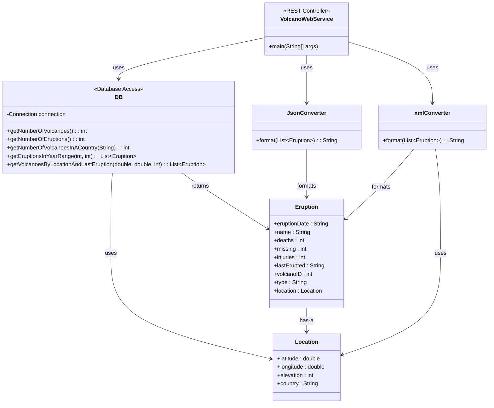

# Volcano Web Service 🌋

**A lightweight Java REST API for exploring a database of 1,604 volcanoes and 855 eruptions. Count the volcanoes in any country, list eruptions between two years as JSON, or find volcanoes near a point on the map that have erupted since a given year, returned as XML.**

> ⚡ Built during an Advanced Programming hackathon with Spark Java, SQLite and JDBC. Everything it needs, including the database, is in this repository.

---

## Table of contents

1. [Features](#features)
2. [How it works](#how-it-works)
3. [Tech stack](#tech-stack)
4. [Getting started](#getting-started)
5. [UML](#uml)
6. [Main classes](#main-classes)
7. [API endpoints](#api-endpoints)
8. [License](#license)

---

## Features

| | Feature |
|---|---|
| 🔢 | Total number of volcanoes and eruptions (`/test`) |
| 🗺️ | Number of volcanoes in a country (`/country`) |
| 📅 | Eruptions between two years, with deaths, injuries, missing people and location, as **JSON** (`/year`) |
| 📍 | Volcanoes near a latitude and longitude that have erupted since a given year, as **XML** (`/location`) |
| 📦 | Ready to run: the SQLite database and every library are bundled |

---

## How it works

```
 HTTP request              Spark Java routes             JDBC                 SQLite
┌──────────────┐        ┌─────────────────────┐      ┌──────────┐      ┌─────────────────┐
│ /year?from=… │ ─────▶ │ VolcanoWebService   │ ───▶ │    DB    │ ───▶ │ data/volcanoes  │
└──────────────┘        │ (port 8088)         │      └──────────┘      │ .db             │
        ▲               └──────────┬──────────┘                        └─────────────────┘
        │                          ▼
        │               JsonConverter / xmlConverter
        └────────────── JSON or XML response
```

1. **Spark Java** listens on port 8088 and sends each request to the matching route.
2. The **DB** class runs the SQL query against the bundled SQLite database and turns each row into `Eruption` and `Location` objects.
3. **JsonConverter** (using `org.json`) or **xmlConverter** (using the Java DOM API) formats the results.

---

## Tech stack

| Area | Technology |
|---|---|
| Language | Java 17 |
| Web framework | Spark Java 3 |
| Database | SQLite (via sqlite-jdbc) |
| JSON | org.json |
| XML | Java DOM (`javax.xml`) |
| IDE project | Eclipse (`.project` / `.classpath` included) |

### Project structure

```
src/uk/ac/mmu/advprog/hackathon/
  VolcanoWebService.java   ← Entry point: starts Spark and defines the routes
  DB.java                  ← Database connection and SQL queries
  Eruption.java            ← Eruption data class
  Location.java            ← Location data class
  JsonConverter.java       ← Eruptions → JSON
  xmlConverter.java        ← Volcanoes → XML
lib/                       ← Spark Java, sqlite-jdbc and org.json jars
data/volcanoes.db          ← The volcano and eruption database
```

---

## Getting started

**Requirements:** JDK 17 or later. There's nothing else to install: the libraries are in `lib/` and the database is in `data/`.

### Option 1: Eclipse

1. Clone the repository:

   ```bash
   git clone https://github.com/adss0/VolcanoWebService.git
   ```

2. In Eclipse, choose **File → Import → Existing Projects into Workspace** and select the folder.
3. Run `VolcanoWebService.java` as a **Java Application**.

### Option 2: Terminal

Run these from the project folder (the service looks for the database at `./data/volcanoes.db`):

```bash
javac -d out -cp "lib/*" src/uk/ac/mmu/advprog/hackathon/*.java
```

```bash
java -cp "out:lib/*" uk.ac.mmu.advprog.hackathon.VolcanoWebService
```

On Windows, use `;` instead of `:` in the second command: `-cp "out;lib/*"`.

The service starts on <http://localhost:8088/>. Try <http://localhost:8088/test> first.

---

## UML

---

## Main Classes

### 1. VolcanoWebService

The **VolcanoWebService** class is the main entry point of the application. It defines all the routes and handles HTTP requests using the **Spark Java** framework. This class interacts with the `DB` class to retrieve data from the SQLite database.

### 2. DB

The **DB** class is responsible for managing the database connection and executing SQL queries. It connects to the SQLite database containing the volcano and eruption data and provides methods to retrieve information from the database.

**Key Methods:**
- `getNumberOfVolcanoes()`: Returns the total count of volcanoes in the database.
- `getNumberOfEruptions()`: Returns the total count of eruptions.
- `getNumberOfVolcanoesInACountry()`: Retrieves the number of volcanoes in a specific country.
- `getEruptionsInYearRange()`: Fetches eruptions that occurred within a given year range.
- `getVolcanoesByLocationAndLastEruption()`: Retrieves volcanoes by location and filters by the last eruption date.

### 3. Location

The **Location** class is a helper data class representing the geographical coordinates of a volcano. It also contains additional information such as the elevation and the country of the volcano.

### 4. Eruption

The **Eruption** class represents an eruption event. It stores details about the eruption, including the date, the volcano's name, its geographical location, and statistics on casualties (deaths, injuries, and missing persons).

---

## API Endpoints

### Test the Service
**GET** `/test`
- Example: `http://localhost:8088/test`
- Response:
  ```text
  Number of volcanoes: 1604
  Number of eruptions: 855
  ```

### Get Number of Volcanoes in a Country
**GET** `/country?search={country_name}`
- Example: `http://localhost:8088/country?search=Japan`
- Response: `113` (Number of volcanoes in Japan)

### Get Eruptions by Year Range
**GET** `/year?from={start_year}&to={end_year}`
- Example: `http://localhost:8088/year?from=1900&to=2000`
- Returns a list of eruptions in **JSON format** that occurred between the specified start year and end year. 
- Example response format:
    ```json
    [
  {
    "date": "1900",
    "injuries": 0,
    "name": "Tullu Moye",
    "missing": 0,
    "location": {
      "elevation": 2343,
      "country": "Ethiopia",
      "latitude": 8.159,
      "longitude": 39.137
    },
    "deaths": 0
  },
  {
    "date": "1900-01-22",
    "injuries": 0,
    "name": "Asamayama",
    "missing": 0,
    "location": {
      "elevation": 2568,
      "country": "Japan",
      "latitude": 36.406,
      "longitude": 138.523
    },
    "deaths": 25
  }
]
    ```

### Get Volcanoes by Location and Last Eruption Date
**GET** `/location?latitude={lat}&longitude={lon}&erupted_since={year}`
- Example: `http://localhost:8088/location?latitude=35&longitude=13&erupted_since=1800`
- Returns a list of volcanoes **in XML format** located near the specified latitude and longitude, that erupted after the specified year.
- Example response format:
```xml
<Volcano id="809">
    <Name>Etna</Name>
    <Type>Stratovolcano</Type>
    <LastErupted>2018-12-26</LastErupted>
    <Location>
        <Latitude>37.748</Latitude>
        <Longitude>14.999</Longitude>
        <Elevation>3357</Elevation>
        <Country>Italy</Country>
    </Location>
</Volcano>
```
---

## License

This project is licensed under the **MIT License**.
